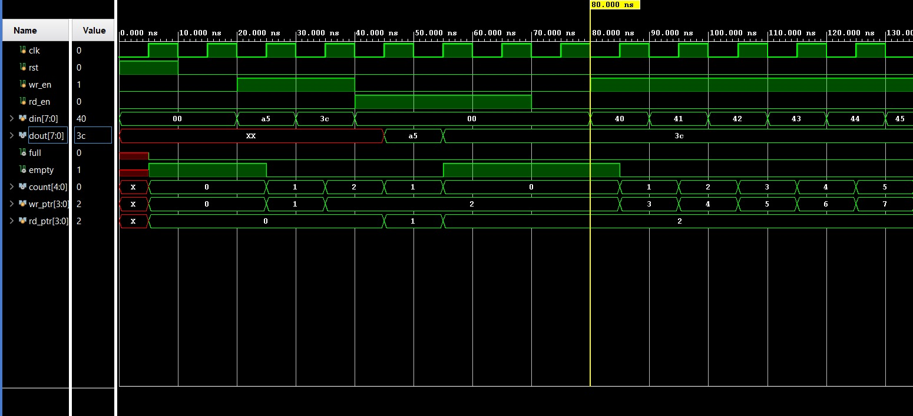
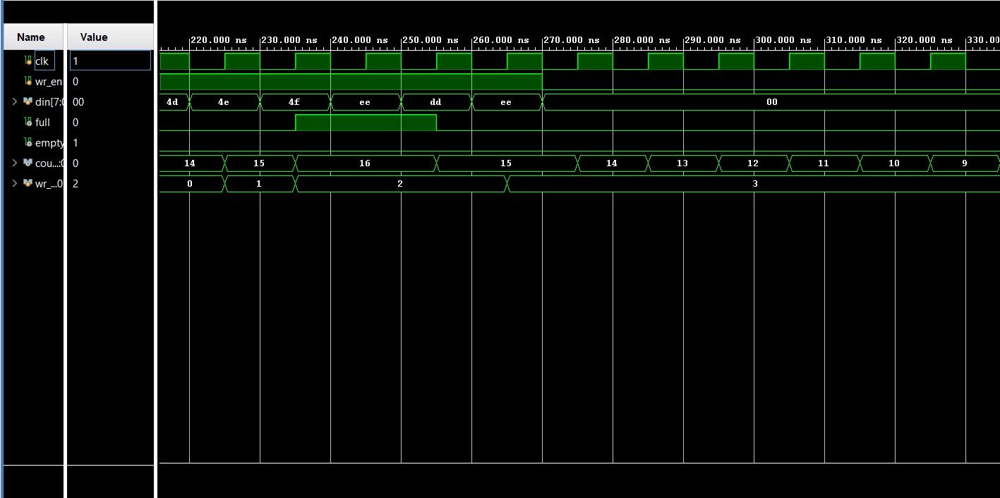
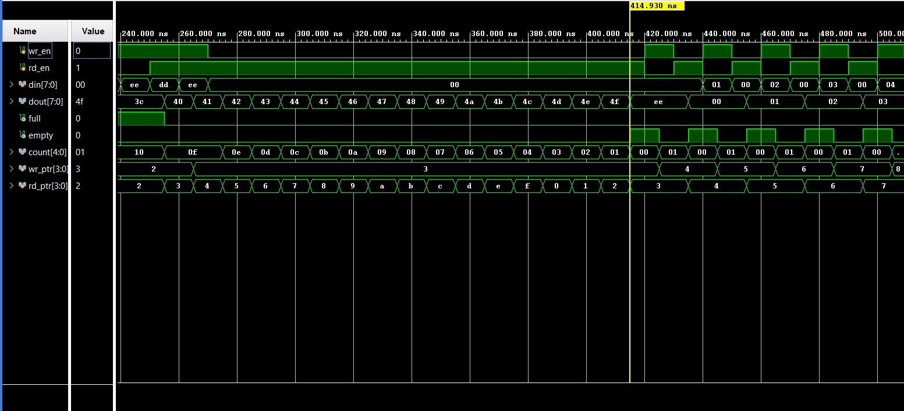
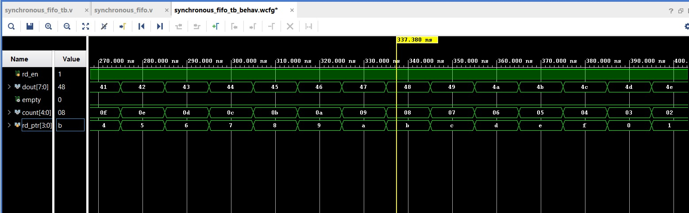
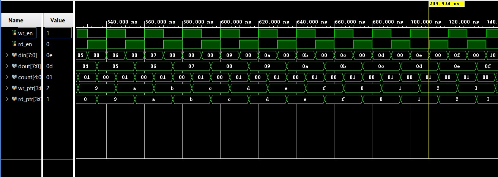

# Synchronous FIFO Design and Verification using Verilog HDL

<p align="center">
  <b>16-Depth | 8-Bit Data Width | Verilog HDL | Xilinx Vivado</b>
</p>

## Overview

This project implements and verifies a **Synchronous First-In First-Out (FIFO)** using Verilog HDL.

The FIFO stores data in a 16-entry memory array, with each entry holding 8 bits. It uses a single clock for both read and write operations and follows the First-In First-Out principle, ensuring that data is read in the same order in which it was written.

The design includes read and write control logic, full and empty flag generation, circular read/write pointers, and an occupancy counter. Functional verification is performed using a self-checking testbench with an independent reference FIFO model in Xilinx Vivado Simulator (XSim).

## Design Specifications

| Parameter | Specification |
|---|---|
| FIFO Architecture | Synchronous FIFO |
| Data Width | 8 bits |
| FIFO Depth | 16 entries |
| Memory Organization | 16 × 8 bits |
| Write Pointer | 4 bits |
| Read Pointer | 4 bits |
| Occupancy Counter | 5 bits |
| Clock | Single clock |
| Reset | Synchronous, active-high |
| HDL | Verilog |
| Simulation | Xilinx Vivado XSim |

## Functional Features

- 8-bit data storage with 16 FIFO locations.
- Independent read and write enable signals.
- Full and empty status flag generation.
- Occupancy tracking from 0 to 16.
- Circular read and write pointer operation.
- Simultaneous read and write support.
- Protection against writing when full.
- Protection against reading when empty.
- Synchronous active-high reset.

## Design Architecture

### 1. Memory Array
- Stores 16 entries, each 8 bits wide.
- Supports data storage and retrieval through read and write pointers.

### 2. Write Pointer
- Identifies the memory location for incoming data.
- Increments after every accepted write.
- Wraps around automatically after reaching address 15.

### 3. Read Pointer
- Identifies the memory location for outgoing data.
- Increments after every accepted read.
- Supports circular buffer operation.

### 4. Occupancy Counter
- Tracks the number of valid entries stored in the FIFO.
- Increments during write-only operations.
- Decrements during read-only operations.
- Remains unchanged when both read and write operations are accepted.

### 5. Status Flags
- **Full:** Asserted when the FIFO contains 16 entries.
- **Empty:** Asserted when the FIFO contains zero entries.

## Simultaneous Read and Write Behavior

| FIFO Condition | Write Request | Read Request | Operation |
|---|---|---|---|
| Empty | 1 | 1 | Write accepted, read rejected |
| Partially Full | 1 | 1 | Both operations accepted |
| Full | 1 | 1 | Read accepted, write rejected |

## Simulation and Verification

The design is verified using a self-checking Verilog testbench and an independent reference FIFO model.

The testbench checks:

- FIFO occupancy counter.
- Full and empty flags.
- Actual read and write pointer positions.
- Output data correctness after valid read operations.
- FIFO data ordering.

### Test Scenarios

1. Synchronous reset operation.
2. Basic write operations and FIFO ordering.
3. Read attempt while FIFO is empty.
4. Filling the FIFO to maximum capacity.
5. Write attempt while FIFO is full.
6. Simultaneous read and write request while full.
7. Simultaneous read and write during normal operation.
8. Complete FIFO readout.
9. Read and write pointer wraparound.
10. Reset while FIFO contains data.
11. Read attempt after reset.
12. Normal operation after reset.

### Simulation Result

**ALL TESTS PASSED**

The testbench reports failures if the actual FIFO output, occupancy count, status flags, or pointers differ from the reference model.

## Waveform Results

The following waveform screenshots demonstrate the functional behavior of the FIFO during simulation.

### 1. Basic FIFO Write and Read Operations

Demonstrates reset, consecutive write operations, FIFO data ordering, and successful read operations.



### 2. FIFO Full Condition

Demonstrates the FIFO reaching its maximum capacity, the full flag assertion, and rejection of an additional write request.



### 3. Simultaneous Read and Write

Demonstrates simultaneous read and write requests and the corresponding behavior of the occupancy counter and pointers.



### 4. FIFO Drain Operation

Demonstrates consecutive read operations as stored data is retrieved until the FIFO becomes empty.



### 5. Pointer Wraparound

Demonstrates circular buffer operation, where the read and write pointers wrap around after reaching the final memory location.



## Tools and Technologies

- **HDL:** Verilog
- **Design and Simulation:** Xilinx Vivado
- **Simulator:** Vivado XSim
- **Verification:** Self-checking testbench with reference model

## Repository Structure

```text
synchronous_fifo/
│
├── synchronous_fifo.v
├── synchronous_fifo_tb.v
│
├── 01_basic_fifo_write_read.png
├── 02_fifo_full_condition.png
├── 03_simultaneous_read_write.png
├── 04_fifo_drain.png
├── 05_pointer_wraparound.png
│
├── README.md
└── LICENSE
```

## Future Scope

- FPGA implementation and hardware validation.
- Timing analysis using appropriate clock constraints.
- Parameterized FIFO architecture.
- Additional corner-case verification.

## Author

**Sanjana Adhikari**

B.Tech – Electronics and Communication Engineering

**Areas of Interest:** Digital Design | RTL Design | VLSI Design
